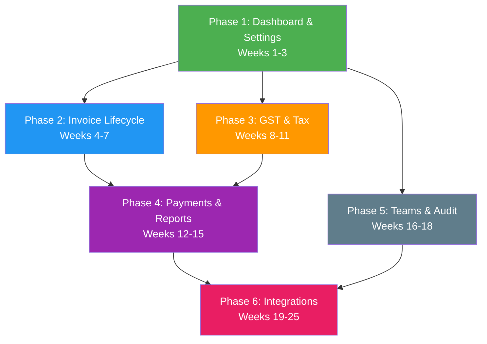

# Complete Implementation Roadmap — Folio → Refrens Parity

> This plan is organized into **6 sequential phases**. Each phase is self-contained and shippable. Every item includes the exact files to create/modify, database migrations, API routes, and integration details specific to this codebase.

---

## Phase 1 — Authenticated Dashboard & Business Settings (Weeks 1-3)

### 1.1 Business Settings UI & API

**Why first**: Every subsequent feature (templates, GST, email) needs business profile data — logo, address, tax ID, default terms, branding colors.

**Database** — New migration `supabase/migrations/202610210001_business_settings.sql`:
```sql
-- Extend billing_businesses with profile columns
ALTER TABLE public.billing_businesses
  ADD COLUMN logo_path text,
  ADD COLUMN address text DEFAULT '',
  ADD COLUMN phone text DEFAULT '',
  ADD COLUMN email text DEFAULT '',
  ADD COLUMN gstin text DEFAULT '',
  ADD COLUMN pan text DEFAULT '',
  ADD COLUMN bank_name text DEFAULT '',
  ADD COLUMN bank_account text DEFAULT '',
  ADD COLUMN bank_ifsc text DEFAULT '',
  ADD COLUMN bank_upi text DEFAULT '',
  ADD COLUMN default_terms text DEFAULT '',
  ADD COLUMN default_notes text DEFAULT '',
  ADD COLUMN default_tax_rate numeric DEFAULT 0,
  ADD COLUMN invoice_prefix text DEFAULT 'INV',
  ADD COLUMN invoice_next_number integer DEFAULT 1,
  ADD COLUMN brand_color text DEFAULT '#3c136b',
  ADD COLUMN updated_at timestamptz NOT NULL DEFAULT now();

-- Allow business owners to update their own business
CREATE POLICY business_update_settings ON public.billing_businesses
  FOR UPDATE TO authenticated
  USING (owner_id = (SELECT auth.uid()))
  WITH CHECK (owner_id = (SELECT auth.uid()));
```

**API** — Modify [app/api/workspace/route.ts](file:///Users/raunakpatel/Downloads/bill/folio/app/api/workspace/route.ts):
- Add `PATCH` handler for updating business profile fields
- Add logo upload via existing `/api/files` pattern (store path in `logo_path`)
- Return full business object including all new columns on `GET`

**Frontend** — New file `public/settings.js`:
- Business profile form: name, logo upload, address, phone, email, GSTIN, PAN
- Bank details section: bank name, account number, IFSC, UPI ID
- Invoice defaults: prefix, next number, default tax rate, default terms/notes
- Branding: color picker for `brand_color`
- Add route `app/settings/route.ts` serving `public/settings/index.html`

---

### 1.2 Authenticated Dashboard

**Frontend** — New files:
- `public/dashboard.js` — main dashboard controller
- `public/dashboard.css` — dashboard-specific styles
- `public/dashboard/index.html` — shell HTML
- `app/dashboard/route.ts` — serves the dashboard page

**Dashboard sections**:

```
┌─────────────────────────────────────────────────────┐
│ Welcome, {user.email}         [Business Selector ▾] │
├──────────┬──────────┬──────────┬────────────────────┤
│ Revenue  │ Pending  │ Overdue  │ Expenses This Mo.  │
│ ₹X.XXL   │ ₹X.XXL   │ ₹X.XXL   │ ₹X.XXL             │
├──────────┴──────────┴──────────┴────────────────────┤
│ Revenue vs Expenses Chart (recharts)                │
│ [Monthly bar chart — last 12 months]                │
├─────────────────────┬───────────────────────────────┤
│ Recent Documents    │ Quick Actions                 │
│ INV-032 — ₹84,960  │ [+ New Invoice]               │
│ INV-031 — ₹53,100  │ [+ New Quotation]             │
│ INV-030 — ₹37,760  │ [+ Record Expense]            │
│ ...                 │ [+ Add Client]                │
├─────────────────────┤ [View Reports]                │
│ Overdue Invoices    │                               │
│ INV-030 — 3 days   │                               │
│ INV-026 — 6 days   │                               │
└─────────────────────┴───────────────────────────────┘
```

**Data aggregation** — New API route `app/api/dashboard/route.ts`:
```typescript
// GET /api/dashboard?business=UUID
// Returns:
// - totalRevenue, totalPending, totalOverdue, totalExpenses (current month)
// - monthlyRevenue[12] — last 12 months revenue
// - monthlyExpenses[12] — last 12 months expenses
// - recentDocuments[5] — latest 5 documents
// - overdueDocuments[] — all docs past due date with balance > 0
// - upcomingSubscriptions[] — next 7 days

// Implementation: query billing_records grouped by collection,
// parse JSONB data fields server-side, aggregate.
// Consider a Supabase RPC function for performance.
```

**Navigation update** — Modify `public/services.js` and `public/services/index.html`:
- Add sidebar/top nav: Dashboard | Documents | Clients | Inventory | Expenses | CRM | Accounting | Settings
- Replace current "Choose a service" directory with the sidebar navigation

---

### 1.3 Document Cloning & Bulk Operations

**Clone** — Add to `public/services.js` `workflowActions()`:
- "Duplicate" button on each document row
- On click: `POST /api/records` with cloned `data` (new ID, new number from sequence, status → draft)

**Bulk archive** — Add to `public/services.js`:
- Checkbox column on table rows
- "Archive selected" button → `Promise.all` of PATCH calls
- "Export selected as CSV" button

---

## Phase 2 — Invoice Lifecycle: Design, Preview, Share, Send (Weeks 4-7)

### 2.1 Multiple Invoice Templates

**Template system** — New directory `public/templates/`:
```
public/templates/
├── classic.js      — current single-column layout (default)
├── modern.js       — two-column header, accent colors
├── elegant.js      — serif fonts, minimal lines
├── compact.js      — dense table, small margins
└── template-api.js — registry and render dispatcher
```

Each template exports a `render(documentData, businessProfile)` function that returns PDF objects (reusing the primitives from [document-export.js](file:///Users/raunakpatel/Downloads/bill/folio/public/document-export.js)).

**Template picker** — Modify the invoice editor (in [invoice-app.js](file:///Users/raunakpatel/Downloads/bill/folio/public/free-online-invoice-generator/invoice-app.js)):
- Add template selector dropdown above preview
- Store selected template ID in document `data.template`
- Live preview switches between template renderers

**Logo embedding in PDF** — Extend [document-export.js](file:///Users/raunakpatel/Downloads/bill/folio/public/document-export.js):
- Accept `logoBytes: Uint8Array` and `logoFormat: 'png'|'jpeg'`
- Embed as inline PDF image XObject (the module already has page/stream primitives)
- Fetch business logo from `/api/files?path=...` when building PDF

---

### 2.2 Authenticated Invoice Editor (Post-Login)

**The core gap**: Currently the guest editor at `/free-online-invoice-generator/` hits a signup wall. Post-login, users need:

**New route** `app/invoice-editor/route.ts` → `public/invoice-editor/index.html`:
- Loads user's business profile (seller details auto-filled)
- Loads client list for buyer selection (combobox from existing records)
- Loads item catalog for line items (from `items` collection)
- Auto-generates invoice number from business prefix + next number
- **Save & Continue** → `POST /api/records` (collection: documents)
- **Design** → opens template picker + live PDF preview
- **Share** → generates shareable link / triggers email send

**Bridging the two editors**:
- Keep the public guest editor at `/free-online-invoice-generator/` for SEO
- After login, redirect "Save & Continue" to the authenticated editor instead of the Refrens signup modal
- Authenticated editor shares the same form layout but pre-fills from stored data

---

### 2.3 Document Preview & Shareable Links

**PDF Preview** — New API route `app/api/documents/preview/route.ts`:
```typescript
// GET /api/documents/preview?id=UUID&business=UUID
// Returns rendered PDF as application/pdf
// Uses document-export.js build() + template + business logo
// Authenticated — user must have access to the business
```

**Shareable link** — New migration + API:
```sql
-- Migration: 202610210002_document_sharing.sql
CREATE TABLE public.billing_shares (
  id uuid PRIMARY KEY DEFAULT gen_random_uuid(),
  business_id uuid NOT NULL REFERENCES public.billing_businesses(id),
  record_id uuid NOT NULL REFERENCES public.billing_records(id),
  token text NOT NULL UNIQUE DEFAULT encode(gen_random_bytes(24), 'base64url'),
  expires_at timestamptz,
  password_hash text,        -- optional password protection
  allow_download boolean DEFAULT true,
  created_at timestamptz NOT NULL DEFAULT now()
);
-- RLS: owner can manage, public can read by token
```

**Public share page** — `app/share/[token]/route.ts`:
- No auth required — token-based access
- Renders PDF in-browser using `<iframe>` or `<embed>`
- Download button if `allow_download` is true
- Optional: "Pay now" button linking to payment gateway (Phase 4)

---

### 2.4 Email Delivery

**Service choice**: [Resend](https://resend.com) (free 100 emails/day, simple API, works from Cloudflare Workers).

**Implementation**:

New file `lib/email.mts`:
```typescript
const RESEND_API_KEY = process.env.RESEND_API_KEY; // stored in .env

export async function sendDocument(options: {
  to: string;
  subject: string;
  businessName: string;
  documentType: string;
  shareUrl: string;
  pdfBytes?: Uint8Array;
}) {
  return fetch('https://api.resend.com/emails', {
    method: 'POST',
    headers: {
      'Authorization': `Bearer ${RESEND_API_KEY}`,
      'Content-Type': 'application/json',
    },
    body: JSON.stringify({
      from: `${options.businessName} <invoices@yourdomain.com>`,
      to: options.to,
      subject: options.subject,
      html: emailTemplate(options),
      attachments: options.pdfBytes ? [{
        filename: `${options.documentType}.pdf`,
        content: btoa(String.fromCharCode(...options.pdfBytes)),
      }] : [],
    }),
  });
}
```

New API route `app/api/documents/send/route.ts`:
```typescript
// POST /api/documents/send
// Body: { id, business, to, subject, message, attachPdf, createShareLink }
// 1. Fetch document + business profile
// 2. Generate PDF if attachPdf
// 3. Create share link if createShareLink
// 4. Send email via Resend
// 5. Update document status to 'sent'
// 6. Log in billing_audit
```

**WhatsApp delivery** — Add alongside email:
- Generate WhatsApp `wa.me` deep link with pre-filled message + share URL
- Open in new tab — no API integration needed for MVP
- Later: WhatsApp Business API via Twilio for programmatic sending

---

## Phase 3 — GST Compliance & Tax Management (Weeks 8-11)

### 3.1 Multi-Slab GST with CGST/SGST/IGST

**Data model change** — Modify `validateRecord` in [business.mjs](file:///Users/raunakpatel/Downloads/bill/folio/lib/business.mjs):

Currently tax is a single `taxRate` percentage. Extend documents to:
```javascript
// New document data fields:
{
  taxType: 'NONE' | 'GST' | 'IGST' | 'VAT' | 'CUSTOM',
  gstMode: 'split' | 'igst',  // split = CGST+SGST, igst = interstate
  items: [
    {
      name, description, quantity, rate,
      hsnCode: '8471',          // HSN/SAC code
      taxRate: 18,              // per-item tax rate (5, 12, 18, 28)
      cessRate: 0,              // additional cess
      discountRate: 0,          // per-item discount %
      discountAmount: 0,        // per-item fixed discount
    }
  ],
  // totals computed by build():
  totals: {
    subtotal, discount, taxableAmount,
    cgst, sgst, igst, cess,
    total, roundOff, grandTotal
  }
}
```

**Modify** [document-export.js](file:///Users/raunakpatel/Downloads/bill/folio/public/document-export.js) `build()` function:
- Calculate per-item tax based on individual `taxRate`
- Split into CGST/SGST (50/50) or IGST based on `gstMode`
- Add cess calculation
- Add HSN-wise tax summary table in PDF
- Round-off logic (round to nearest rupee)

**HSN code database** — New file `public/hsn-codes.json`:
- Curated list of ~1200 common HSN/SAC codes with descriptions and default GST rates
- Searchable combobox in invoice editor for item HSN selection

---

### 3.2 Credit Notes & Debit Notes

**Add document types** to the `TITLES` map in [document-export.js](file:///Users/raunakpatel/Downloads/bill/folio/public/document-export.js):
```javascript
const TITLES = {
  // ... existing types
  'credit-note': 'Credit Note',
  'debit-note': 'Debit Note',
};
```

**Link to original** — CN/DN `data` includes `originalDocumentId` referencing the parent invoice. Validation in `validateRecord()` ensures the referenced document exists.

**Workflow** — Add to [workflows.mjs](file:///Users/raunakpatel/Downloads/bill/folio/lib/workflows.mjs):
```javascript
// invoice → credit-note (returns/adjustments)
// invoice → debit-note (additional charges)
```

---

### 3.3 GST Reports (GSTR-1 / GSTR-3B Summary)

**New API route** `app/api/reports/gst/route.ts`:
```typescript
// GET /api/reports/gst?business=UUID&period=2026-10&type=gstr1
// Aggregates all invoices in the period:
// - B2B invoices (buyer has GSTIN) → table with invoice-wise details
// - B2C invoices (no GSTIN) → rate-wise summary
// - Credit/debit notes
// - HSN-wise summary
// - Returns JSON data for frontend rendering + CSV/Excel export

// For GSTR-3B: aggregate outward supplies, ITC from purchase records,
// net tax payable calculation
```

**Frontend** — New `public/reports/gst.js`:
- Period selector (month/year)
- GSTR-1 sections: B2B, B2CS, CDNR, HSN Summary
- GSTR-3B summary: outward supplies, ITC, net payable
- Export as CSV/JSON

---

### 3.4 e-Invoicing (IRN via NIC)

**Architecture**: Government e-invoicing requires:
1. **GSP registration** — Register with a GST Suvidha Provider (e.g., ClearTax, Masters India API)
2. **IRN generation flow**:
   ```
   Invoice data → JSON schema per NIC spec → POST to GSP API
   → Receive IRN + signed QR + digital signature
   → Store in document data, embed QR in PDF
   ```

**Implementation**:

New file `lib/einvoice.mts`:
```typescript
export async function generateIRN(document: any, business: any) {
  // 1. Map document data to NIC e-invoice JSON schema v1.1
  // 2. POST to GSP endpoint (configured in business settings)
  // 3. Return { irn, ackNo, ackDate, signedInvoice, qrCode }
}

export async function cancelIRN(irn: string, reason: string) {
  // POST cancellation to GSP
}
```

New API route `app/api/documents/einvoice/route.ts`:
- `POST` — generate IRN for a document
- `DELETE` — cancel IRN
- Store IRN metadata in document JSONB `data.einvoice: { irn, ackNo, ... }`

**QR code in PDF** — Extend `document-export.js` to render QR code (use a minimal QR encoder, ~200 lines pure JS).

**Business settings** — Add GSP credentials fields:
- GSP provider selector
- API key / secret (encrypted in Supabase vault or env vars)
- Auto-IRN toggle (generate IRN on "sent" status change)

---

### 3.5 e-Way Bill

**Similar pattern to e-invoicing**:

New file `lib/ewaybill.mts`:
```typescript
export async function generateEWB(document: any, transport: any) {
  // Map to NIC e-Way Bill JSON schema
  // POST to GSP endpoint
  // Return { ewbNo, ewbDate, validUpto }
}
```

**Transport details** — Already partially captured in delivery challan. Extend with:
- Vehicle number, transporter ID, distance
- Transport mode (road/rail/ship/air)
- Store in document `data.transport`

---

## Phase 4 — Payment Collection & Financial Reports (Weeks 12-15)

### 4.1 Payment Gateway Integration (Razorpay)

**Flow**:
```
Share link → Buyer opens → Views invoice → "Pay Now"
→ Razorpay checkout modal → Payment captured
→ Webhook → Record payment in billing_records
→ Update document status → Notify seller
```

**Database** — Migration `202610210003_payments.sql`:
```sql
CREATE TABLE public.billing_payment_links (
  id uuid PRIMARY KEY DEFAULT gen_random_uuid(),
  business_id uuid NOT NULL REFERENCES public.billing_businesses(id),
  document_id uuid NOT NULL REFERENCES public.billing_records(id),
  razorpay_link_id text,
  amount numeric NOT NULL CHECK (amount > 0),
  currency text NOT NULL DEFAULT 'INR',
  status text NOT NULL DEFAULT 'created',
  paid_at timestamptz,
  razorpay_payment_id text,
  created_at timestamptz NOT NULL DEFAULT now()
);
```

**Business settings** — Add to business profile:
- Razorpay key ID + secret (stored securely)
- Auto-create payment link toggle

**API routes**:
- `app/api/payments/create-link/route.ts` — creates Razorpay payment link
- `app/api/payments/webhook/route.ts` — receives Razorpay webhook, verifies signature, records payment
- `app/api/payments/status/route.ts` — checks payment status

**Share page update** — Add "Pay ₹X,XXX" button on shared invoice that opens Razorpay checkout.

---

### 4.2 Client & Vendor Statements

**API route** `app/api/reports/statement/route.ts`:
```typescript
// GET /api/reports/statement?business=UUID&client=UUID&from=2026-01-01&to=2026-12-31
// Returns:
// - All invoices for this client in period
// - All payments received against those invoices
// - All credit/debit notes
// - Running balance
// - Opening/closing balance
```

**PDF statement** — Extend `document-export.js` with a `buildStatement()` function:
- Header: business + client details
- Table: Date | Document | Type | Amount | Payment | Balance
- Footer: totals, aging summary

---

### 4.3 Financial Reports

New directory `public/reports/`:
```
public/reports/
├── index.html        — report selector
├── reports.js        — report controller
├── profit-loss.js    — P&L report
├── balance-sheet.js  — balance sheet (from journals)
├── aging.js          — receivable/payable aging
├── sales.js          — sales by client/item/period
├── tax.js            — tax collected/paid summary
└── custom.js         — user-defined date range + filters
```

**API route** `app/api/reports/route.ts`:
```typescript
// GET /api/reports?business=UUID&type=profit-loss&from=...&to=...
// Aggregation logic:
//
// Profit & Loss:
//   Revenue = sum of invoice totals (status: sent/paid)
//   COGS = sum of expenses (category: 'COGS')
//   Operating expenses = sum of expenses (other categories)
//   Net profit = Revenue - COGS - Operating expenses
//
// Aging:
//   Group overdue invoices by: 0-30, 31-60, 61-90, 90+ days
//
// Sales:
//   Aggregate by client, by item, by month
//
// Balance Sheet:
//   Derive from journal entries (assets = liabilities + equity)
```

**Charts** — Use `recharts` (already a dependency in [package.json](file:///Users/raunakpatel/Downloads/bill/folio/package.json)):
- Bar charts for revenue/expense trends
- Pie charts for expense categories
- Aging bucket visualization

---

## Phase 5 — Team Collaboration & Audit (Weeks 16-18)

### 5.1 Multi-User Team Access

**The database already supports this!** Look at the existing migration:
```sql
-- Already exists in 202610200001_billing_foundation.sql:
CREATE TABLE public.billing_members (
  business_id uuid NOT NULL REFERENCES public.billing_businesses(id),
  user_id uuid NOT NULL REFERENCES auth.users(id),
  role text NOT NULL CHECK(role IN ('owner','admin','editor','viewer')),
  ...
);
```

And the RLS functions already check `billing_members`:
```sql
-- billing_can_access checks both owner AND members
SELECT EXISTS(SELECT 1 FROM public.billing_members
  WHERE business_id=b AND user_id=(SELECT auth.uid())
  AND (NOT writing OR role IN ('owner','admin','editor')))
```

**What's needed is just the UI + invitation API**:

**API route** `app/api/team/route.ts`:
```typescript
// GET  /api/team?business=UUID         — list members
// POST /api/team                       — invite member (by email)
// PATCH /api/team                      — change role
// DELETE /api/team                     — remove member

// Invite flow:
// 1. Look up email in auth.users (via Supabase admin API)
// 2. If exists: insert into billing_members
// 3. If not: send invitation email (Resend) with signup link
//    + pending_invitations table
```

**Migration** `202610210004_team_invitations.sql`:
```sql
CREATE TABLE public.billing_invitations (
  id uuid PRIMARY KEY DEFAULT gen_random_uuid(),
  business_id uuid NOT NULL REFERENCES public.billing_businesses(id),
  email text NOT NULL,
  role text NOT NULL CHECK(role IN ('admin','editor','viewer')),
  invited_by uuid NOT NULL REFERENCES auth.users(id),
  accepted boolean DEFAULT false,
  created_at timestamptz NOT NULL DEFAULT now(),
  UNIQUE(business_id, email)
);
```

**Frontend** — New section in Settings page:
- Team members list with role badges
- "Invite member" form (email + role selector)
- Remove/change role actions (owner only)

---

### 5.2 Audit Trail UI

**Already captured in the database!** The `billing_audit` table already exists and is populated by the trigger in `202610200001`:
```sql
CREATE TABLE public.billing_audit (
  id bigint, business_id uuid, record_id uuid,
  actor_id uuid, action text, version integer, created_at timestamptz
);
```

**API route** `app/api/audit/route.ts`:
```typescript
// GET /api/audit?business=UUID&record=UUID&limit=50
// Returns audit entries with actor email (join auth.users)
// Sorted by created_at desc
```

**Frontend** — Add "History" button on each record that opens a slide-over:
```
Oct 20, 10:15 — raunak@example.com — Created
Oct 20, 11:30 — raunak@example.com — Updated (v2)
Oct 20, 14:00 — raunak@example.com — Archived
```

---

## Phase 6 — Integrations & Platform (Weeks 19-25)

### 6.1 External API with API Keys

**Migration** `202610210005_api_keys.sql`:
```sql
CREATE TABLE public.billing_api_keys (
  id uuid PRIMARY KEY DEFAULT gen_random_uuid(),
  business_id uuid NOT NULL REFERENCES public.billing_businesses(id),
  name text NOT NULL,
  key_hash text NOT NULL,           -- SHA-256 of the key
  key_prefix text NOT NULL,         -- first 8 chars for display
  permissions text[] NOT NULL DEFAULT '{"read"}',
  last_used_at timestamptz,
  created_at timestamptz NOT NULL DEFAULT now()
);
```

**API key middleware** — New file `lib/api-auth.mts`:
```typescript
export async function authenticateApiKey(req: Request) {
  const key = req.headers.get('X-API-Key') || req.headers.get('Authorization')?.replace('Bearer ', '');
  if (!key) return null;
  const hash = await sha256(key);
  // Look up key_hash in billing_api_keys
  // Return { businessId, permissions }
}
```

**Versioned API** — New route group `app/api/v1/`:
```
app/api/v1/
├── documents/route.ts    — CRUD documents
├── clients/route.ts      — CRUD clients
├── invoices/route.ts     — alias for documents?type=invoice
├── payments/route.ts     — record payments
└── webhooks/route.ts     — manage webhook subscriptions
```

**Webhooks** — On record create/update, check `billing_webhooks` table and POST to registered URLs.

---

### 6.2 AI Accounting Agent

**Architecture**: Use OpenAI API (or any LLM) with function calling to query business data.

**New files**:
```
lib/ai-agent.mts          — LLM orchestration
app/api/ai/chat/route.ts  — streaming chat endpoint
public/ai/index.html      — chat UI
public/ai/chat.js         — chat frontend
```

**Function tools** the AI can call:
```typescript
const tools = [
  { name: 'get_revenue', description: 'Get total revenue for a period' },
  { name: 'get_expenses', description: 'Get expenses by category' },
  { name: 'get_overdue', description: 'List overdue invoices' },
  { name: 'get_client_balance', description: 'Get outstanding balance for a client' },
  { name: 'create_invoice', description: 'Create a draft invoice' },
  { name: 'get_gst_summary', description: 'Get GST summary for filing' },
];
```

Each tool maps to existing API routes. The LLM sees the business context and answers natural language questions like:
- "How much does Northstar owe me?"
- "Create an invoice for Arc & Co for brand guidelines, ₹60,000"
- "What's my GST liability for October?"

---

### 6.3 IndiaMART CRM Integration

**IndiaMART provides a Lead Manager API** (requires IndiaMART seller account):

New file `lib/indiamart.mts`:
```typescript
export async function fetchIndiaMArtLeads(apiKey: string, since: string) {
  const response = await fetch(
    `https://mapi.indiamart.com/wservce/enquiry/listing/JEESSION/${apiKey}/Start=0/End=50/ModifiedSince=${since}`
  );
  return response.json();
}

export function mapToLead(imLead: any) {
  return {
    name: imLead.SENDER_NAME,
    email: imLead.SENDER_EMAIL,
    phone: imLead.SENDER_MOBILE,
    amount: 0,
    status: 'New',
    notes: `IndiaMART enquiry: ${imLead.QUERY_MESSAGE}\nProduct: ${imLead.QUERY_PRODUCT_NAME}`,
    source: 'indiamart',
    externalId: imLead.UNIQUE_QUERY_ID,
  };
}
```

**Sync mechanism**: Cloudflare Cron Trigger (or Supabase Edge Function) polls every 15 minutes:
- Fetch new leads since last sync timestamp
- Deduplicate by `externalId`
- Insert into `billing_records` (collection: leads)

**Business settings** — Add IndiaMART API key field.

---

### 6.4 MCP Server

**Publish an MCP server** so AI tools can interact with the billing data:

New file `lib/mcp-server.mts`:
```typescript
// MCP tool definitions:
export const mcpTools = {
  list_invoices: { /* input schema, handler */ },
  create_invoice: { /* ... */ },
  get_client_balance: { /* ... */ },
  record_payment: { /* ... */ },
  get_gst_summary: { /* ... */ },
};
```

**API route** `app/api/mcp/route.ts`:
- Implements the MCP JSON-RPC protocol
- Uses API key authentication (from 6.1)
- Exposes read/write tools for invoices, clients, payments

---

### 6.5 Recurring Invoice Auto-Generation

**Cloudflare Cron Trigger** — Add to `wrangler.json`:
```json
{
  "triggers": {
    "crons": ["0 6 * * *"]  // Daily at 6 AM IST
  }
}
```

**Worker handler** — New file `build/subscription-worker.ts`:
```typescript
export default {
  async scheduled(event: ScheduledEvent, env: Env) {
    // 1. Query all active subscriptions where nextDate <= today
    // 2. For each: call workflowDocument('subscription-invoice')
    // 3. Optionally auto-send via email
    // 4. Update subscription nextDate
  }
};
```

---

### 6.6 Mobile Apps (React Native / Expo)

**Approach**: Since all business logic is already in API routes, mobile apps are thin clients.

```
mobile/
├── package.json          — Expo + React Native
├── app/
│   ├── (tabs)/
│   │   ├── dashboard.tsx
│   │   ├── documents.tsx
│   │   ├── clients.tsx
│   │   └── more.tsx
│   ├── invoice/[id].tsx
│   ├── login.tsx
│   └── settings.tsx
├── lib/
│   ├── api.ts            — fetch wrapper with auth token
│   └── storage.ts        — secure token storage
└── components/
    ├── InvoiceCard.tsx
    ├── DocumentForm.tsx
    └── PaymentButton.tsx
```

**Auth** — Use Supabase `@supabase/supabase-js` with AsyncStorage for token persistence.

**Key mobile features**:
- Camera → expense receipt capture → upload to `/api/files`
- Push notifications via Expo Notifications for payment received, overdue reminders
- Share invoice PDF via native share sheet
- Offline draft storage with sync on reconnect

---

## Phase Summary & Dependency Graph



## Priority Shortcuts

If you want to ship revenue-generating features fastest, this is the **minimum viable order**:

| Priority | Item | Rationale | Weeks |
|----------|------|-----------|-------|
| 🥇 | Business settings + Dashboard | Foundation for everything | 2 |
| 🥈 | Authenticated invoice editor + Email send | Core product loop | 3 |
| 🥉 | Multi-slab GST + HSN | India compliance = table stakes | 2 |
| 4 | Razorpay payment links | Monetization | 1 |
| 5 | Reports (P&L, aging) | User retention | 2 |
| 6 | Team access (UI only — DB is ready) | Growth | 1 |
| — | **Total MVP** | | **~11 weeks** |

> [!TIP]
> The **team access database layer already exists** — `billing_members`, RLS policies, and role checks are all in the [foundation migration](file:///Users/raunakpatel/Downloads/bill/folio/supabase/migrations/202610200001_billing_foundation.sql). You just need the invite UI and member management API. Similarly, the **audit trail** is already being captured — you only need to expose it in the UI.
